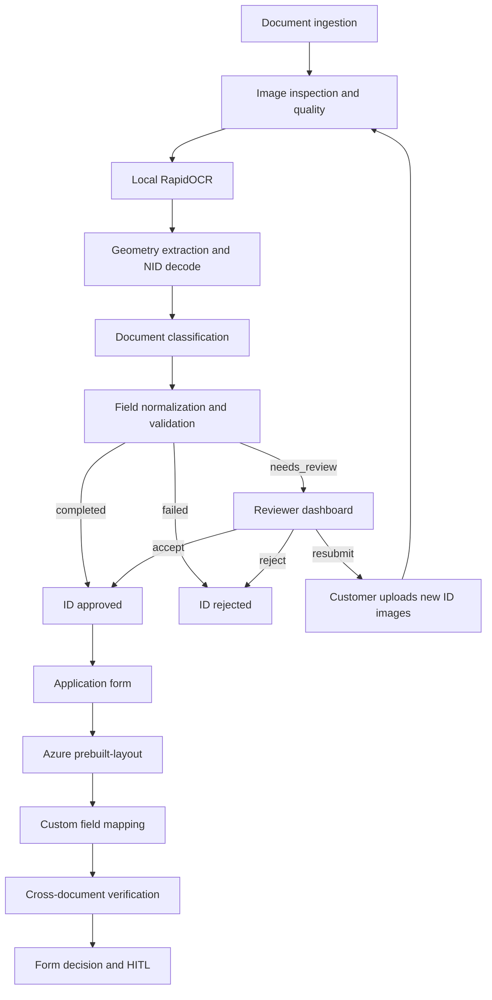

# End-to-End Document Intelligence & Identity Verification System

A complete onboarding application for Egyptian National ID and application-form processing: document ingestion, classification, OCR, structured extraction, validation, cross-document checks, human review, and persistent application workflow.

The system is presented through a **Customer Portal** and a **Reviewer Dashboard**, with FastAPI persistence in SQLite.

FastAPI · RapidOCR · Azure Document Intelligence · OpenCV · Pydantic · SQLite

---

## Workflow




| Stage                                   | What happens                                                                                                                                                 |
| --------------------------------------- | ------------------------------------------------------------------------------------------------------------------------------------------------------------ |
| Document ingestion and image processing | Front and back National ID images are inspected for format, size, and card-like geometry, then stored with the application.                                  |
| Document classification                 | The pipeline labels `target_id`, `non_target`, or `uncertain` from OCR evidence and visual cues.                                                             |
| OCR and structured extraction           | Local RapidOCR reads Arabic print. Geometry-aware mapping produces name, address, national ID, gender, religion, expiry, serial, and derived NID attributes. |
| Field normalization and validation      | Eastern/Western digits, NID structure, age, expiry, front/back agreement, and quality checks produce a machine decision.                                     |
| Identity verification                   | The 14-digit national ID is decoded and compared with printed fields, front and back, and onboarding policy.                                                 |
| Cross-document verification             | After ID acceptance, the application form is mapped and compared with the Stage 1 identity snapshot.                                                         |
| Human review                            | Confidence, missing fields, and policy flags route a case to the reviewer. Original OCR remains on the record; corrections are stored separately.            |
| Application decisions                   | Automated and reviewer decisions yield `approved`, `pending_review`, `rejected`, or `resubmission_required` for the ID, independently of form status.        |
| Persistent records                      | Applications, images, extraction, form mapping, and review history are stored in SQLite.                                                                     |
| Portals                                 | Customers submit documents and follow status. Reviewers inspect images, fields, and form pages, then record decisions.                                       |


Local OCR, application validation, and human-review decisions are separate results. They are not merged into a single score.

## Local OCR architecture

Egyptian National IDs contain highly sensitive personal information. **RapidOCR** is used as a privacy-conscious processing layer: identity-document images are read on the local machine and are not transmitted to an external OCR provider during ordinary onboarding.

The local pipeline is designed for controlled, resource-constrained environments (CPU ONNX Runtime, Arabic PP-OCRv5 mobile recognition). The same application architecture can host more powerful OCR or Document AI services when deployment requirements, processing resources, and data-handling policy permit them.

National ID images stay on the machine during Stage 1. Form pages leave the machine when a completed application form is submitted for Azure layout analysis.

## Azure Document Intelligence

Azure `prebuilt-layout` analyzes the **Application Form**. It returns text, layout, tables, selection marks, and spatial information. It does not emit the business fields used by onboarding.

A Python mapping layer (`form_map.py`) converts that layout into application-specific fields: `full_name`, `national_id`, `gender`, `mobile`, and `speed`. The application then normalizes values, assigns field status (`present` / `unreadable` / `absent`), validates them, and cross-checks name, National ID, and gender against the Stage 1 identity snapshot (reviewer `final_value` when present).

## Key capabilities

- Dual-side Arabic OCR on-device via RapidOCR and ONNX Runtime
- Geometry-aware ID extraction and 14-digit NID decode (date of birth, gender, birth governorate)
- Named onboarding checks: age ≥ 18, expiry, front/back NID agreement, field presence, image quality
- Duplicate control on image hashes and canonical NID claims
- Independent National ID and application-form human review
- Azure `prebuilt-layout` plus custom form mapping and Stage 1 cross-check
- Customer Portal and Reviewer Dashboard over a persistent application store


## Architecture


| Module            | Responsibility                                               |
| ----------------- | ------------------------------------------------------------ |
| `api.py`          | HTTP surface for customer, reviewer, and form analysis       |
| `workflow.py`     | Application lifecycle and form HITL                          |
| `pipeline.py`     | End-to-end local processing of an ID pair                    |
| `imaging.py`      | Decode, quality heuristics, back-side crops                  |
| `ocr.py`          | Arabic OCR engine                                            |
| `extract.py`      | Field assignment from text, position, and keywords           |
| `nid.py`          | National ID structure and derived attributes                 |
| `classify.py`     | Document-type classification                                 |
| `validate.py`     | Policy checks and machine decision                           |
| `review.py`       | Reviewer Accept gates for the ID                             |
| `azure_layout.py` | Azure `prebuilt-layout` client                               |
| `form_map.py`     | Layout JSON → application fields and Stage 1 cross-check     |
| `store.py`        | SQLite, uploads, duplicate claims, file replace with backups |


OCR output is the system of record for Stage 1. Reviewer edits live in `corrections`. Form corrections are stored the same way, separately from the original mapped fields.

The staged application record (stored images, extraction, validation, independent ID and form status, reviewer decisions) is the extension point for a future external identity-verification provider. That provider would run as an optional, explicit step alongside local OCR, not inside it.

## Technologies


| Area               | Library / service                                |
| ------------------ | ------------------------------------------------ |
| API and UI hosting | FastAPI, Uvicorn, static HTML/JS                 |
| ID OCR             | RapidOCR (`rapidocr[rtl]`), ONNX Runtime         |
| Imaging            | OpenCV, Pillow, NumPy                            |
| Form layout        | Azure AI Document Intelligence `prebuilt-layout` |
| Field models       | Pydantic v2                                      |
| Persistence        | SQLite                                           |
| Tests              | pytest, httpx                                    |


Python **3.11–3.13**.

## National ID processing

1. Customer uploads front and back images (`POST /v1/applications`).
2. The server rejects empty, corrupt, tiny, or non-card-looking files before a case is stored.
3. RapidOCR reads Arabic print on CPU. Models download on first inference.
4. `extract.py` assigns fields using normalized coordinates, title-relative name geometry, and Arabic keyword maps, including dedicated crops for gender, religion, and expiry on the back.
5. `nid.py` validates the 14-digit structure (century, date, governorate) and derives date of birth, gender, and governorate.
6. `classify.py` labels `target_id`, `non_target`, or `uncertain`.
7. `validate.py` runs named checks. Automated `completed` → ID `approved`; `failed` → `rejected`; `needs_review` → reviewer console.

Duplicate front image, back image, or canonical NID on another application returns HTTP 409. The same application may resubmit when the reviewer requests new photos. Resubmitting the National ID clears previous form data and the stored form file.

A CLI runs the same ID pipeline without creating an application:

```powershell
.\.venv\Scripts\python.exe -m egyid --front path\to\front.jpg --back path\to\back.jpg
```

Values are redacted by default. Pass `--show-values` to print extracted fields.

## Application form processing

Azure `prebuilt-layout` returns page lines, tables, selection marks, and polygons. `form_map.py` maps that JSON onto five fields:


| Field         | Mapping rule (page 1 header band)                                              |
| ------------- | ------------------------------------------------------------------------------ |
| `full_name`   | Arabic remainder on a line/cell containing الإسم / الاسم                       |
| `national_id` | 14-digit structurally valid NID beside رقم إثبات الشخصية / الرقم القومي        |
| `gender`      | Selection marks on a row that contains ذكر / أنثى (left = أنثى, right = ذكر)   |
| `mobile`      | 11-digit value starting with `01` beside رقم الهاتف المحمول                    |
| `speed`       | Handwritten 30 / 70 / 100 Mbps near السرعة; the printed option trio is ignored |


Each field has a status: `present`, `unreadable`, or `absent`. Missing or unreadable identity values are never treated as a successful match against Stage 1.

If any review flag is set, `form_status` is `pending_review`. If none are set, the form is stored as `approved`. A second form upload returns HTTP 409 unless the form is `resubmission_required`.

Standalone layout analysis (no application record):

```powershell
curl.exe -s -X POST "http://127.0.0.1:8000/v1/forms/layout" -F "document=@path\to\form.pdf;type=application/pdf"
```


## Human review

**National ID.** While `status` is `pending_review`, the reviewer inspects both images, edits extracted fields, and sends `accept`, `reject`, or `resubmit` to `POST /v1/review/applications/{id}/decision`. Reject and resubmit require a reason. Accept is blocked until review validation passes (including matching front/back NID). Original OCR is not overwritten.

**Application form.** While `form_status` is `pending_review`, the reviewer inspects mapped fields and the uploaded file, edits values, and sends `accept`, `reject`, or `resubmit` to `POST /v1/review/applications/{id}/form/decision`. That call does not change ID `status`.

The customer portal polls while either the ID or the form is `pending_review`.

## Project structure

```
src/egyid/          Pipeline, Azure layout client, form mapper, API
static/             Customer portal and reviewer dashboard
static/forms/       Place `dsl-application.pdf` here for blank-form download
tests/              Unit and API tests (Azure and OCR are mocked or skipped)
scripts/            Synthetic parser helpers
.env.example        Azure variable names (placeholders only)
```

Local ID photos, Azure JSON dumps, SQLite, uploads, and credentials belong in gitignored locations such as `National IDs/`, `Azure Doc/`, `artifacts/`, and `.env`.

## Installation and local setup

**Python 3.11–3.13**

```powershell
python -m venv .venv
.\.venv\Scripts\python.exe -m pip install -e ".[dev]"
copy .env.example .env
```

```bash
python -m venv .venv
source .venv/bin/activate
pip install -e ".[dev]"
cp .env.example .env
```

Run commands from the repository root so `static/` and `.env` resolve correctly.

## Environment configuration

Copy `.env.example` to `.env` (gitignored) and set:

```
DOCUMENTINTELLIGENCE_ENDPOINT=https://YOUR-RESOURCE.cognitiveservices.azure.com/
DOCUMENTINTELLIGENCE_API_KEY=
```


| Variable                        | Used by                                 |
| ------------------------------- | --------------------------------------- |
| `DOCUMENTINTELLIGENCE_ENDPOINT` | Form upload and `POST /v1/forms/layout` |
| `DOCUMENTINTELLIGENCE_API_KEY`  | Same                                    |


Values are read from the process environment, or from `.env` if the variable is not already set (`azure_layout.py`). Stage 1 RapidOCR does not use these variables.

Place a blank PDF at `static/forms/dsl-application.pdf` for blank-form download. See `static/forms/README.md` for expected labels.

## How to run the application

```powershell
.\.venv\Scripts\python.exe -m uvicorn egyid.api:app --app-dir src --host 127.0.0.1 --port 8000
```

```bash
python -m uvicorn egyid.api:app --app-dir src --host 127.0.0.1 --port 8000
```

OCR models load on the first ID inference.

## Interfaces


| Surface            | URL                                                          |
| ------------------ | ------------------------------------------------------------ |
| Customer portal    | [http://127.0.0.1:8000/](http://127.0.0.1:8000/)             |
| Reviewer dashboard | [http://127.0.0.1:8000/review](http://127.0.0.1:8000/review) |
| Health             | [http://127.0.0.1:8000/health](http://127.0.0.1:8000/health) |
| OpenAPI (Swagger)  | [http://127.0.0.1:8000/docs](http://127.0.0.1:8000/docs)     |
| ReDoc              | [http://127.0.0.1:8000/redoc](http://127.0.0.1:8000/redoc)   |


**Customer.** Submit front and back ID images. Status is `approved`, `pending_review`, `rejected`, or `resubmission_required`. After ID approval, download the blank form, upload the completed page, and follow `form_status`. A new form is accepted only when none is on file or the reviewer requested form resubmission.

**Reviewer.** Open a case, inspect ID images and (when present) the form, correct fields, and record ID or form decisions independently.

## API

Customer responses include `status`, `form_status`, `stage`, `customer_message`, `can_resubmit`, `next_stage`, and `application_form`. Reviewer detail includes `extraction`, ID `corrections`, `review`, image URLs, `form`, and `form_url`.


| Method | Path                                         | Purpose                                                                                                  |
| ------ | -------------------------------------------- | -------------------------------------------------------------------------------------------------------- |
| `GET`  | `/health`                                    | Liveness                                                                                                 |
| `GET`  | `/`                                          | Customer portal                                                                                          |
| `GET`  | `/review`                                    | Reviewer dashboard                                                                                       |
| `POST` | `/v1/applications`                           | Create application (`front`, `back`, `customer_id`). Duplicate → 409. Bad upload → 422.                  |
| `GET`  | `/v1/applications/{id}`                      | Customer view                                                                                            |
| `GET`  | `/v1/customers/{customer_id}/applications`   | Applications for that customer                                                                           |
| `POST` | `/v1/applications/{id}/resubmit`             | Replace ID images while `resubmission_required`. Clears any previous form.                               |
| `GET`  | `/v1/applications/{id}/front`                | Stored front image                                                                                       |
| `GET`  | `/v1/applications/{id}/back`                 | Stored back image                                                                                        |
| `GET`  | `/v1/applications/{id}/form/blank`           | Blank PDF (ID must be approved)                                                                          |
| `POST` | `/v1/applications/{id}/form`                 | Upload completed form. Runs Azure layout, maps fields, cross-checks Stage 1. Missing Azure config → 503. |
| `GET`  | `/v1/applications/{id}/form`                 | Uploaded form file                                                                                       |
| `GET`  | `/v1/review/applications`                    | Reviewer queue                                                                                           |
| `GET`  | `/v1/review/applications/{id}`               | Reviewer detail                                                                                          |
| `POST` | `/v1/review/applications/{id}/decision`      | ID decision `{ "action", "corrections", "reason" }`                                                      |
| `POST` | `/v1/review/applications/{id}/form/decision` | Form decision; does not change ID `status`                                                               |
| `POST` | `/v1/forms/layout`                           | Ungated `prebuilt-layout` JSON                                                                           |
| `POST` | `/v1/id-documents`                           | ID pipeline without creating an application                                                              |
| `POST` | `/v1/reviews`                                | Persist a review JSON                                                                                    |
| `GET`  | `/v1/reviews/{review_id}`                    | Download a persisted review                                                                              |


## Tests

```powershell
.\.venv\Scripts\python.exe -m pytest
```

```bash
python -m pytest
```

The suite covers NID decoding, extraction geometry, classification, validation, duplicates and resubmit, review gates, form mapping, form review, Stage 1 cross-check, and **mocked** Azure layout. Optional tests that need local ID photographs or Playwright are skipped when those samples are not present.

## Example workflow

1. Start Uvicorn from the repository root.
2. Open the customer portal and submit National ID front and back images (use documents you are allowed to process; do not commit them).
3. If status is `pending_review`, open the reviewer dashboard, inspect the card, correct fields if needed, and accept.
4. When the ID is `approved`, download the blank form (if `dsl-application.pdf` is in place), fill it by hand, and upload it. This step calls Azure.
5. If the form is `pending_review`, the reviewer inspects mapped fields and accepts, rejects, or requests a new form. The ID decision stays unchanged.
6. The customer portal shows `status` and `form_status` as separate outcomes.


## Future Production Integrations

The onboarding workflow is structured so an external identity-verification provider can be added later as a separate, explicit step: stored ID images, application records, and reviewer decisions already live independently of local OCR.

One such provider is **VLens** (Digital Identity verification: national ID capture, liveness, and tenant-enabled authority checks). A production integration would keep provider credentials on the backend, invoke the vendor only when a user starts that step, and store the vendor result beside—not merged into—local extraction and human review.

## Privacy & Data Handling

The system follows a privacy-conscious document processing approach. Egyptian National ID images are processed locally using RapidOCR, while Application Form documents are analyzed through Azure Document Intelligence.

Sensitive documents and application data are maintained within the local application environment. Only the document-processing operations configured to use external services transmit document content to those services.